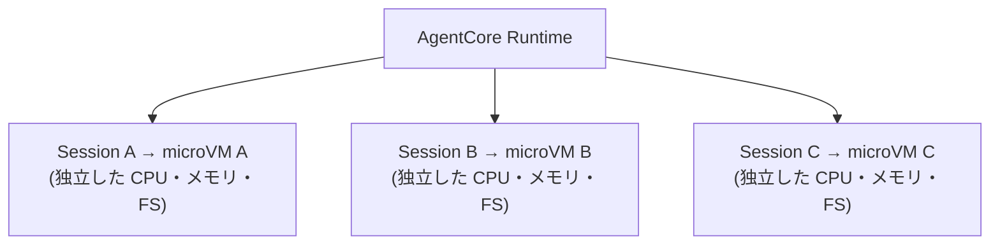
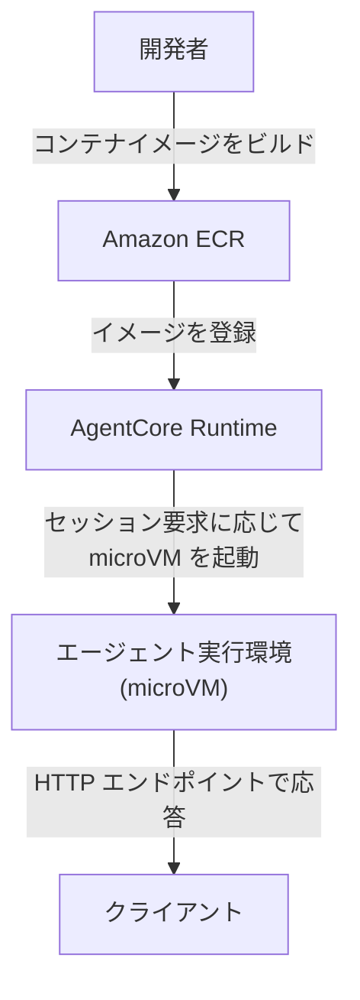

# AgentCore Runtime 詳細

> **調査日**: 2026-11-11
> **情報源**: AWS 公式 Developer Guide、Release notes、What's New。仕様・クォータ・リージョンは変わるため、利用時はリンク先の最新情報を確認してください。

---

## 概要

AgentCore Runtime は、AI エージェントをサーバーレスで安全に実行するためのコンテナ実行基盤です。AWS Firecracker の microVM 技術を活用したセッション分離により、エンタープライズレベルのセキュリティを提供します。

---

## アーキテクチャ

### microVM によるセッション分離



- 各セッションは専用の Firecracker microVM 上で動作
- セッション間でのデータアクセスは不可（完全分離）
- セッション終了時に microVM を廃棄し、すべてのリソースをサニタイズ
- メモリ・ディスクはエフェメラル（永続データは Memory 等の外部サービスに保存）

### デプロイモデル



コンテナイメージでのデプロイに加え、Python と Node.js は直接コードデプロイにも対応しています。直接コードデプロイは Docker/ECR を使わずにコードをデプロイする方式です。OS レベルのカスタマイズや独自バイナリが必要な場合は、コンテナ方式を選択します。

---

## 主要な仕様・制限

| 項目 | 値 |
|------|-----|
| 最大セッション時間 | 8 時間 |
| アイドルタイムアウト | 約 15 分（設定による） |
| 同時セッション数 | リージョン・Service Quotas による（固定値ではない） |
| コンテナアーキテクチャ | コンテナ方式では ARM64 に対応 |
| 直接コードデプロイ | Python、Node.js |
| 対応エージェントフレームワーク | LangGraph, Strands Agents, CrewAI, カスタム等（任意） |
| 対応モデルプロバイダー | Amazon Bedrock, OpenAI, Anthropic, オープンソース等 |

### Runtime V2（2026 年 9 月提供開始）

Runtime V2 は既存 Runtime と並ぶプラットフォームバージョンです。AWS の発表では、エージェント環境のスナップショットからセッションを起動する方式と、使用状況に応じてメモリを確保・解放する弾力的なメモリ管理が案内されています。2026 年 11 月 9 日の AWS Weekly Roundup では、V2 の提供リージョン拡大、1 セッションあたりの接続数上限の引き上げ、CloudWatch の `OverheadLatency` メトリクスも案内されました。V2 の利用方法、リージョン、数値条件は変更される可能性があるため、Release notes とクォータページを参照してください。

### デプロイ方式の選択

| 方式 | 適するケース |
|------|--------------|
| 直接コードデプロイ | Python / Node.js の一般的な依存関係で、Docker イメージ管理を省きたい場合 |
| コンテナイメージ | OS パッケージ、ネイティブ依存、実行環境のカスタマイズが必要な場合 |

---

## セキュリティ

- **ゼロトラストセッション境界**: 各セッションはネットワーク・計算リソース・ファイルシステムが完全に分離
- **特権操作の閉じ込め**: 外部 API 呼び出し・コード実行・ファイル操作はすべて microVM 内に閉じ込め
- **資格情報の漏洩防止**: セッション内の資格情報・シークレットはセッション境界を越えない
- **ロギング・監査**: CloudWatch 統合による詳細なセッションログと監査証跡

---

## 可観測性

- **CloudWatch 統合**: セッションログ・パフォーマンスメトリクスを自動収集
- **カスタムソリューション**: OpenTelemetry ベースの外部監視ツールとの統合も可能

---

## SDK・ツール

- **bedrock-agentcore-starter-toolkit**: エージェントのコンテナ化・デプロイを簡略化する Python SDK
- **`@app.entrypoint` デコレータ**: エージェントの HTTP エンドポイントを定義するためのシンプルな API

```python
from bedrock_agentcore.runtime import BedrockAgentCoreApp

app = BedrockAgentCoreApp()

@app.entrypoint
def invoke(payload, context):
    # エージェントのロジックをここに実装
    user_input = payload.get("prompt", "")
    response = my_agent(user_input)
    return {"response": response}
```

---

## 参照リソース

- [AWS Docs: AgentCore Release notes](https://docs.aws.amazon.com/bedrock-agentcore/latest/devguide/release-notes.html)
- [AWS Docs: Runtime quotas and limits](https://docs.aws.amazon.com/bedrock-agentcore/latest/devguide/bedrock-agentcore-limits.html)
- [AWS What's New: 新しい AgentCore Runtime（2026-09）](https://aws.amazon.com/about-aws/whats-new/2026/09/new-agentcore-runtime-generally-available/)
- [AWS Weekly Roundup（2026-11-09）](https://aws.amazon.com/blogs/aws/aws-weekly-roundup-agentcore-runtime-v2-amazon-dynamodb-bulk-put-items-and-more-november-9-2026/)
- [AWS Docs: Python 直接コードデプロイ](https://docs.aws.amazon.com/bedrock-agentcore/latest/devguide/runtime-get-started-code-deploy-python.html)
- [AWS Docs: Node.js 直接コードデプロイ](https://docs.aws.amazon.com/bedrock-agentcore/latest/devguide/runtime-get-started-code-deploy-node.html)
- [AWS What's New: Node.js 直接コードデプロイ（2026-04）](https://aws.amazon.com/about-aws/whats-new/2026/04/amazon-bedrock-agentcore-runtime/)
- [AWS Docs: セッション分離](https://docs.aws.amazon.com/bedrock-agentcore/latest/devguide/runtime-sessions.html)
- [bedrock-agentcore-starter-toolkit クイックスタート](https://aws.github.io/bedrock-agentcore-starter-toolkit/examples/agentcore-quickstart-example.html)
- [GitHub チュートリアル: Runtime](https://github.com/awslabs/amazon-bedrock-agentcore-samples/tree/main/01-tutorials/01-AgentCore-runtime)
- [Building AI Agents with AgentCore Runtime (dev.to)](https://dev.to/aws-builders/building-ai-agents-with-amazon-bedrock-agentcore-runtime-a-complete-setup-guide-50oh)
- [Guidance for Multi-Agent Orchestration using AgentCore](https://github.com/aws-solutions-library-samples/guidance-for-multi-agent-orchestration-using-bedrock-agentcore-on-aws)
